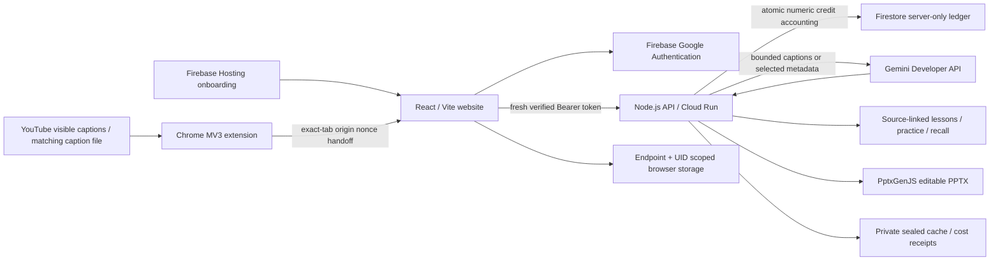

# Delta architecture

This diagram describes the locked source snapshot, not a claim that every native path is production-qualified. Live availability may be paused by operator/provider policy.

Ordinary accounts have a US$0.50 lifetime estimated AI allowance and strict less-than-US$0.10 session reservations. An explicit paid candidate also checks a durable project-wide allowance before generation. These controls do not guarantee invoice ceilings or provider availability.

Website and extension libraries are separate. Full private history, account credentials and Firebase tokens do not cross the native handoff. Firebase holds identity and numeric allowance state; captions/lessons remain browser or private runtime data. Cloud Run is the inference/application backend; Firebase Hosting is static onboarding.

Learning creates four teaching cards and two application exercises. Source IDs resolve to supplied caption anchors; they do not independently verify truth. Practice checks match AI-authored keys. PPTX and practice require no additional model call. Map classification accepts at most 12 selected metadata items and retains unresolved outcomes rather than filling gaps.

The provider route and `gemini-3.8-flash` remain pinned. No File Search, Memory Bank, automatic retries or alternate-model fallback are introduced. Native Chrome Learn/My Map handoffs and Store distribution require separate installed-path qualification; this source makes no universal-video or worldwide-provider claim.
