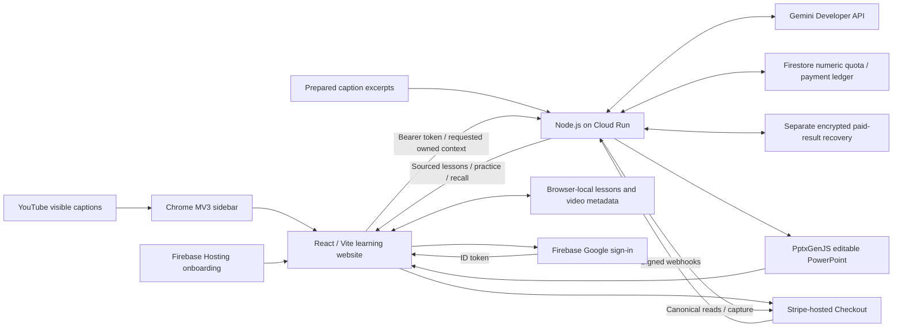
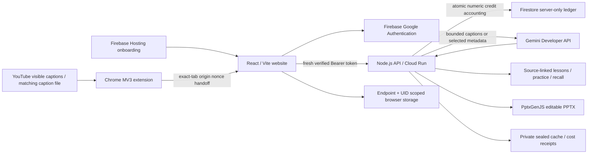

# Delta learning architecture

**Current release, 21 October 2026:** see [verified launch status](launch-status.md). Cloud Run `delta-assistant-support-a064ba8` serves the website/API; the shared US$10 project guard is active and the storefront uses the independent Delta LIVE account. Store distribution and actual LIVE capture remain unqualified.

The extension bridge carries bounded caption or metadata data, never a Google identity token. A YouTube URL alone does not guarantee captions. History imports do not upload or index every video's transcript. Website and extension stores remain separate. The exact canonical-origin, identity and ownership gates protect learning, practice, recall, exports and paid recovery. Free allowance is US$0.50 lifetime; each learning session remains below US$0.10 estimated cost. The unchanged Gemini route has no automatic provider/model fallback.

Stripe's server-owned US$5 amount, immutable merchant/mode and canonical state control fulfilment. The backend reserves delivery capacity before capture and grants 100 imports / 20 sessions once. Retained Sandbox targets reconcile existing receipts; they are not another public storefront. See [payment boundaries](payments.md), [technologies](technologies.md) and [privacy](https://delta-assistant-613646062582.us-central1.run.app/privacy.html).

Historical public source snapshot

The material below describes the earlier public snapshot; its deployment and availability statements are historical.

# Delta architecture

This diagram describes the locked source snapshot, not a claim that every native path is production-qualified. Live availability may be paused by operator/provider policy.

Ordinary accounts have a US$0.50 lifetime estimated AI allowance and strict less-than-US$0.10 session reservations. An explicit paid candidate also checks a durable project-wide allowance before generation. These controls do not guarantee invoice ceilings or provider availability.

Website and extension libraries are separate. Full private history, account credentials and Firebase tokens do not cross the native handoff. Firebase holds identity and numeric allowance state; captions/lessons remain browser or private runtime data. Cloud Run is the inference/application backend; Firebase Hosting is static onboarding.

Learning creates four teaching cards and two application exercises. Source IDs resolve to supplied caption anchors; they do not independently verify truth. Practice checks match AI-authored keys. PPTX and practice require no additional model call. Map classification accepts at most 12 selected metadata items and retains unresolved outcomes rather than filling gaps.

The provider route and `gemini-3.8-flash` remain pinned. No File Search, Memory Bank, automatic retries or alternate-model fallback are introduced. Native Chrome Learn/My Map handoffs and Store distribution require separate installed-path qualification; this source makes no universal-video or worldwide-provider claim.

