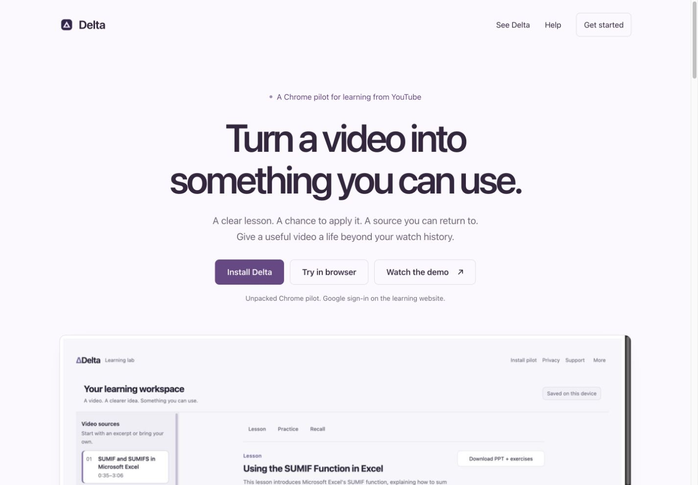
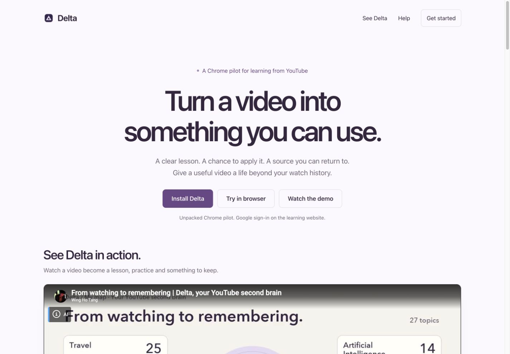
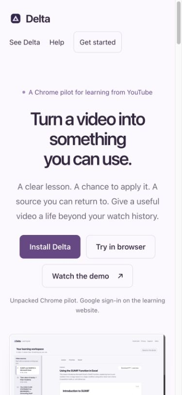
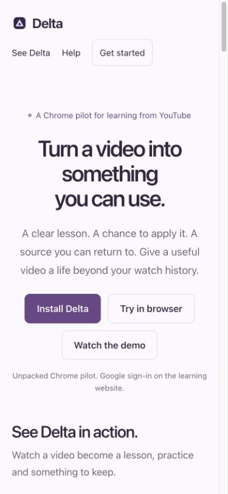
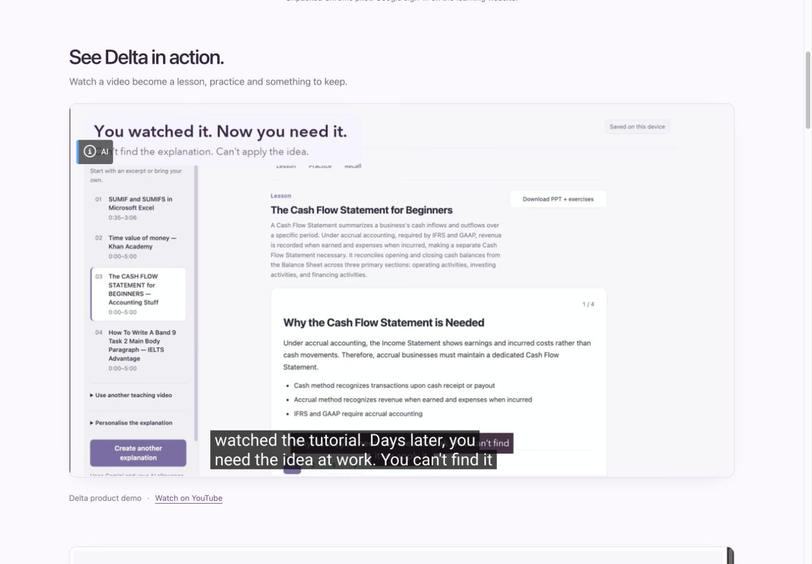
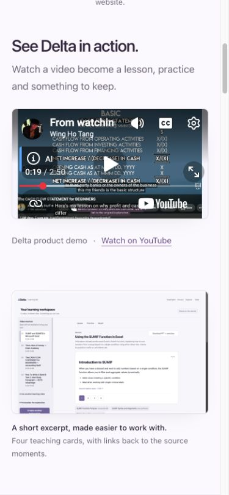

# Extension 0.7.1 and the landing demo — 20 October 2026

The [landing page](https://delta-511903.web.app/#demo) now plays the existing public product demo in its demo section. **Watch the demo** and **See Delta** scroll to that player. The installation action downloads [Chrome pilot 0.7.1](https://delta-511903.web.app/downloads/Delta-Chrome-MVP-0.7.1.zip) and tells users to confirm **Delta 0.7.1** on Chrome’s extension card after Reload.

## Exact candidate and package

- Product candidate: `99f7c85712b05ba9123c0f64241dc7f1cc14f722`; sanitized public equivalent: `cea8713`.
- ZIP: `Delta-Chrome-MVP-0.7.1.zip`, **1,917,583 bytes**, **12 files**, SHA-256 `c7116a0427ce50dacfcc500ab90ba431b4df7eda20cf0fc86fcbdca9eb5ffe55`.
- Compared with the prior qualified 0.7.0 ZIP (`a77d8de…`), only `manifest.json` differs: `version` is now `0.7.1`. The other 11 files are byte-identical. Permissions and all other manifest fields are identical. The backend API version remains independent.
- The packager now refuses to overwrite an existing versioned ZIP with different bytes, leaves its receipt/archive intact on rejection, and permits identical rebuilds. Changed extension bytes require a new manifest version. Earlier archives remain in source; do not delete them to bypass this check.

Chrome uses the manifest version for display when no `version_name` is set. See the [official manifest version reference](https://developer.chrome.com/docs/extensions/reference/manifest/version).

## Verification

The extension build passed its MV3 entry-point, icon, content-bundle and native-panel assertions. **11/11 packaging tests passed**, including a regression test that first failed against the previous overwrite behavior. A fresh extraction of the exact clean committed candidate passed CRC/hash, manifest asset and byte-identical archive reconstruction checks. No model call was needed: the extension executable/CSS payloads are unchanged from the prior qualified package.

Hosting-only deployment completed for `delta-511903`. Both `web.app` and `firebaseapp.com` returned the exact candidate HTML, CSS, ZIP and four existing image assets: **16 checks passed** across those seven files plus the reserved auth handler on both origins. The auth-handler response remained byte-identical. The new versioned ZIP path was absent before deployment; its immutable download headers and all package hashes were checked afterward. A real browser download through the landing page’s 0.7.1 link matched the same ZIP digest and passed manifest/CRC/file-hash verification.

Live embedded playback reached **7.31 seconds / 170.02 seconds**, with `paused=false` and `readyState=4`. The public demo ID is `XokomcChqWs`; the separate SUMIF learning-source ID remains `dI8w0utjUc0`. Layout checks at nominal 390, 768 and 1440 px showed no horizontal overflow, and the player retained its media aspect ratio. Local preview and live assets were byte-compared.

CSP adds only the YouTube privacy-enhanced frame origin to the landing paths. The iframe has an accessible title, lazy loading, an origin-preserving referrer policy, visible playback controls and a direct YouTube fallback. This mode still connects to Google; see [YouTube’s embed guidance](https://support.google.com/youtube/answer/171780?hl=en) and [player requirements](https://developers.google.com/youtube/iframe_api_reference). Existing auth handlers, Cloud Run runtime, backend/model settings, account credit and browser records were not changed by this static deployment.

**Latest native qualification — 20 October, 16:37 Hong Kong:** the [complete accounting-path report](native-extension-pptx-2026-10-20.md#actual-caption-recovery-and-complete-accounting-path--20-october-1637-hong-kong) supersedes the earlier caption-pending status. Installed 0.7.1 accepted actual YouTube captions from 0:00–5:00, completed fresh Google sign-in, generated one new lesson, retained both exercise-key matches, returned a source-linked answer to a narrower question, saved/opened a new seven-slide PPTX in Keynote, and retained the lesson and matches after reload. The displayed cumulative paid-equivalent estimate was US$0.0221 for generation and two questions, including the broader question that returned no-source fallback; this is not a provider invoice. The earlier transcript-loading cause and intermittent sign-in failures remain unexplained, and the first recall miss remains a quality limit. This qualifies one sampled source path. Real-money billing, Store distribution and production monitoring remain unqualified. The initial static/version work above made no model calls; the later native run is recorded separately in that report.

## Earlier saved-lesson follow-up — before 16:37 Hong Kong

The reloaded 0.7.1 accounting-video handoff completed through native **Learning lab → Learn current video**, Google sign-in and the existing saved lesson; see the [16:25 native follow-up](native-extension-pptx-2026-10-20.md#native-follow-up--20-october-1625-hong-kong). The completed hosted tab was then independently observed with a signed-in account, matching video `DiVPAjgmnj0`, the selected accounting source and its saved lesson, and was left open for the user.

One contemporaneous fresh SUMIF native sign-in returned the closed-sign-in notice after account selection. The later successful accounting sign-in establishes recovery, not a root-cause fix; both outcomes are retained. At this earlier stage, YouTube's transcript had no timestamped rows and the hosted page retained its explicit missing-captions notice. No new AI generation, payment, history import or runtime/configuration change was made during this saved-lesson check. That signed-in capture is retained privately rather than publishing the user's account/credit view.

## Matched Before / After captures

Before: approved production baseline matching product `2b95ae5` / public `b0a6b6f`. After: candidate `99f7c85` / public `cea8713`. Same English locale, page-top state and nominal viewport. The content captures are 1425 × 990 px on desktop and 375 × 812 px on phone, excluding browser chrome/scrollbar. The hero demo button now scrolls within the page, and the new video section replaces the first static image as the next section. The existing product images remain farther down the page.

| Desktop before | Desktop after |
| --- | --- |
|  |  |

[Original desktop before](assets/extension-071-landing-demo-2026-10-20/before-landing-desktop.jpg) · [Original desktop after](assets/extension-071-landing-demo-2026-10-20/after-landing-desktop.jpg)

| Phone before | Phone after |
| --- | --- |
|  |  |

[Original phone before](assets/extension-071-landing-demo-2026-10-20/before-landing-phone.jpg) · [Original phone after](assets/extension-071-landing-demo-2026-10-20/after-landing-phone.jpg)

## Playback views

The desktop capture is from live production playback. The phone capture is the same byte-qualified candidate in local preview, paused after successful playback; it demonstrates reflow rather than a synchronized video frame. Both use the already public product demo, with no private account/library screenshot added.

[Original live playback capture](assets/extension-071-landing-demo-2026-10-20/live-demo-desktop.jpg)

[Original phone player capture](assets/extension-071-landing-demo-2026-10-20/after-demo-phone.jpg)
