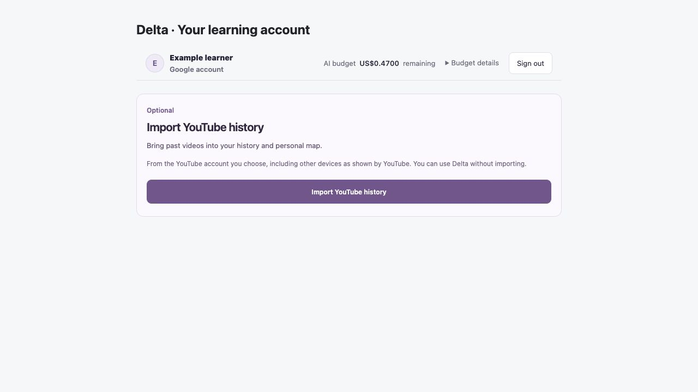
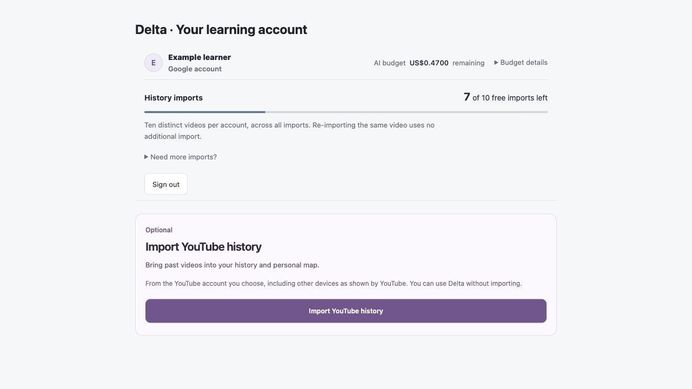
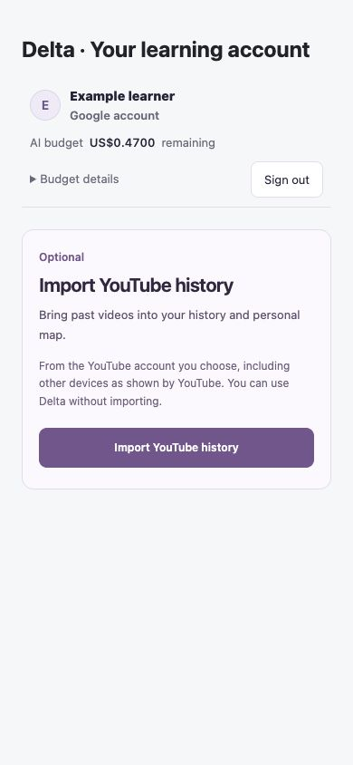
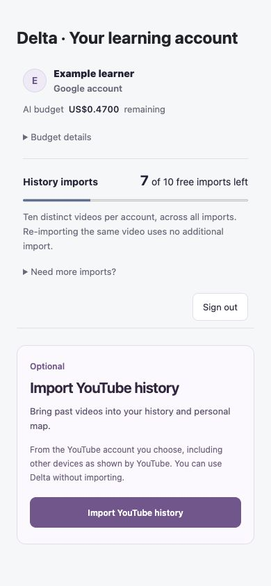

# Free history import entitlement verification

Status: implementation and local package verified; not production-release qualified. Payments are disabled. No live Gemini generation, Stripe payment, Google sign-in, Firestore mutation or deployment was performed in this verification.

## Delivered behavior

- Ten cumulative distinct canonical YouTube import registrations per verified Delta account. Both native history sources use the same hosted admission path. Duplicate import, deletion or reinstall cannot create a new server allowance.
- The default YouTube scope is ten visible videos, without scrolling. Broader scopes are disabled in the new UI. Existing history, map results and local lessons are retained.
- Website Google identity stays on the website. Only bounded operation/video IDs and a validated data-only receipt cross the nonce/tab/origin-bound bridge. A separate Firestore ledger stores keyed identifiers and counters, not imported titles, viewing dates or captions.
- Import units appear separately from the original US$0.50 lifetime estimated AI credit. Unavailable balance stays unknown. The US$5 pack (+100 imports, 20 bounded learning sessions) is explicitly not on sale; no Checkout or purchased entitlement is active.

## Current evidence

| Gate | Result |
|---|---|
| `pnpm test:server` | 384 passed, 0 failed |
| `pnpm test:extension` | 309 passed, 0 failed |
| `node --test deploy/competition/*.test.mjs` | 9 passed, 0 failed |
| `pnpm build` and `pnpm build:extension` | Passed |
| Real built-extension archive validation | 12 files; ZIP entries, CRCs, paths and declared assets verified |
| Browser UI review | 1280×720 and 390×844; available, exhausted and unavailable balances; only latest-ten scope enabled; no horizontal overflow at 390px |
| Scoped hygiene | Whitespace check and secret-pattern scan passed; no environment file, personal history or caption source added |

The integration tests execute the actual background entry, both native collectors, hosted bridge, real local HTTP server, study client and entitlement reducer. They replace external Google token verification, Chrome I/O and Firestore I/O with controlled fixtures. Ten imports succeed, a repeated ID adds zero, an eleventh new ID is denied, and legacy local content stays unchanged. Separate tests cover concurrency, restart, replay conflict, UID isolation, unregistered classification denial, source-account changes, permission revocation, cancelled admission and stale balance responses. These deterministic results do not establish real-browser OAuth, real Firestore durability or installed-extension behavior.

A broader-suite failure initially retained the old twelve-video queue expectation. The fixture now checks the intended ten-video batches (`10, 10, 5` for 25 synthetic rows); the final full extension suite passes. No gate was bypassed.

## Exact local artifact

- Archive: `Delta-Chrome-MVP-0.7.0.zip`
- Bytes: 1,909,544
- SHA-256: `74b070473eeca9f90337cc332dffe7943e91441890f45a1e673d853053008f7c`
- Scoped source/package binding (42 changed code, test, public-notice and package files, sorted path + NUL + binary SHA-256 + NUL): `d17eaadcb7b3296ae0df2295df434ec06aa23280431e220bdb60fb82a63172ec`

The archive is a local candidate, not the current hosted download or a Chrome Web Store release. Matching backend/website and extension installation must be qualified together before promotion. The original signing material must remain stable; rotating it would change keyed import identities. Existing saved learning remains outside the new admission requirement.

## Paired UI evidence

Both pairs use the same synthetic learner, US$0.47 AI credit, three used imports, English locale and collapsed details. The before account component matches public baseline `77d29a7`; after is the source candidate covered by the binding above. Screenshots contain no real account or history data.

| View | Before | After |
|---|---|---|
| Desktop, 1280×720 |  |  |
| Phone, 390×844 |  |  |

The account panel adds a distinct import balance/progress indicator and a disclosure of the unavailable one-time offer. Existing AI credit and sign-out controls remain available when import allowance cannot be read.

## Remaining qualification

1. Stripe account reconnection, merchant selection and required integration-planner flow before any payment code; then funded-capacity reservation, signed webhook/capture handling and purchased grants.
2. Exact deployed-candidate admission with both permitted and denied principals, real Firestore transactions, installed extension handoffs and representative existing saved content. This candidate has not been deployed, and earlier Cloud Run acceptance does not qualify it.
