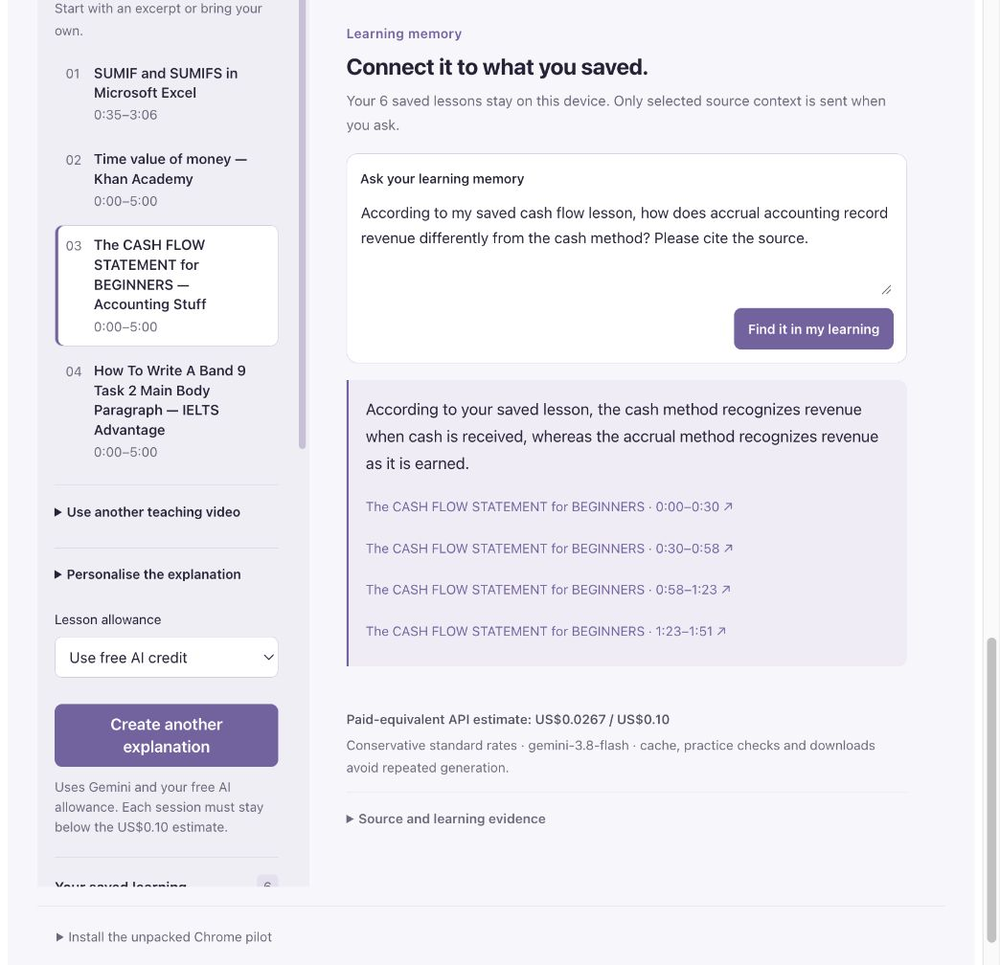

# Sign-in, recall and availability hardening — 20 October 2026

Status: **public pilot patch delivered; commercial launch remains incomplete.**
The Google sign-in and saved-learning paths were exercised through the actual
website. Live payments, store publication, an operational private support
mailbox and actual alert-email receipt are separate pending qualifications.

## Exact released artifacts

| Artifact | Identity |
| --- | --- |
| Public application source | `5282392`; privacy/support follow-up `b911d33` |
| Cloud Run | `delta-assistant-hardening-b911d33`, 100% traffic, no temporary tags |
| Final image | `sha256:5713b510917ff62b0108e0d289cbaf9332baf16118459ad5c78e252da170b659` |
| Extension pilot | 0.7.2, 12 files, 1,917,583 bytes |
| ZIP SHA-256 | `c97d440f0c7a4a3b4ea18da79d4fc1a554b6164a85a0d0eb4fdd81ca25e2a1f1` |

Both Firebase Hosting domains link and serve the exact 0.7.2 ZIP. The earlier
0.7.1 download is retained. Its 11 executable/style/icon files are byte-identical
to 0.7.2; only the manifest version changes. The installed 0.7.1 folder was
checked against its published receipt. This does not claim a new store install
or that Chrome has reloaded 0.7.2.

The final privacy-only image has all **96 server and Web asset files identical**
to the application image qualified below. Its changed privacy/support HTML was
checked byte-for-byte on the candidate and canonical live hostname. The existing
runtime environment, secret references, service identity and resource settings
were preserved. No model, key, billing or allowance setting changed.

## Reproducible defects and corrections

Sign-in could wait indefinitely for the Firebase SDK, initial auth observer,
identity token or Google popup. A late result could also survive disposal or
sign-out, and concurrent sign-in requests could create multiple popups. The SDK,
first observer and token waits now each have a 20-second deadline; the popup has
a 60-second deadline. Requests share one active sign-in attempt, and lifecycle,
account and attempt checks fence late results. No automatic authentication retry,
provider fallback or persistence-policy change was added. A late server-verified
recovery clears the earlier timeout message.

Recall could select captions from one saved version of a video but resolve its
anchor ID against another version, producing the wrong timestamp. Retrieval and
citation resolution now share one canonical source version per video. The active
lesson wins for its video; other videos use their newest supplied saved version.
Ranking uses exact normalized words and anchor-bound concept labels, shares the
selection across videos, and retains the 16-anchor / 14,000-character bounds.
Foreign-owned memories and invalid citations still fail closed.

These fixes do not establish the cause of every historical Google popup failure,
guarantee every model answer, or turn all viewing history into searchable text.
Recall remains limited to the owned saved lessons supplied by the current client.

## Verification and compatibility

| Check | Result and limit |
| --- | --- |
| Deterministic gate | 452 server + 310 extension + 15 website + 14 packaging = **791 passed**, no skipped failures |
| Builds and isolated image | Web/MV3 builds passed; non-root, read-only, network-disabled smoke passed with zero provider calls |
| Existing account and library | Six saved lessons restored; the native-caption accounting lesson retained its two exercise-key matches |
| Fresh Google sign-in | One signed-out ordinary Chrome tab selected the authorized test account and reached verified account credit and the same local library; no retry |
| Real recall and download transport | One real question returned the accounting comparison with four timestamped links; authenticated PPTX preparation exposed its ready Save link without another AI generation |

The four returned spans were manually checked against the public source captions:
0:00–0:30 introduces the cash method; 0:30–0:58 contrasts accrual revenue;
0:58–1:23 explains cash-method income; 1:23–1:51 restates accrual recognition.
The session's cumulative conservative API estimate rose from US$0.0221 to
**US$0.0267**, below US$0.10. This is one supported answer, not a model-accuracy,
learning-effectiveness or invoice measurement. The earlier no-source answer is
retained in the [native qualification](native-extension-pptx-2026-10-20.md).
That report also retains the actual seven-slide PPTX save/open evidence; the
unchanged export engine was not requalified by another OS save in this patch.

Canonical public auth configuration returns 200 and the default US$0.50 allowance.
Anonymous session and ask requests return 401; cross-origin Study access returns
403; private source/environment paths return 404. The temporary candidate host
also correctly failed the canonical-origin guard. Firebase's reserved auth
handler remains available. These checks are bounded evidence, not an exhaustive
penetration test or a guarantee of future availability.

## Native monitoring and remaining work

Three Google Cloud uptime checks cover onboarding, the learning page and public
auth configuration, every five minutes from three USA regions. One enabled alert
policy requires two regions to fail the same check for five minutes and routes
to the operator's email channel. The latest sample had all nine check/region
series passing. Probes do not sign in, generate AI or read private user content.
Actual notification-email receipt is **not yet qualified**, and product telemetry
remains unknown. Configuring a channel is not proof of successful delivery.

The configured maximum is 80,352 regional probe executions in a 31-day month,
within Google's published one-million-execution free allowance. This does not
measure the account's total monthly infrastructure invoice or establish an SLA.
See [Google's monitoring pricing](https://cloud.google.com/products/observability/pricing).

Commercial launch still requires the separate Delta merchant's owner-completed
opening/activation, dedicated credentials and live-mode integration qualification;
Chrome Web Store publisher/listing approval; a working private support/privacy
contact; and notification-delivery qualification. Sandbox results remain Sandbox
results. The updated provider disclosure reflects the existing billing-enabled
project under [Google's current Gemini terms](https://ai.google.dev/gemini-api/terms).
