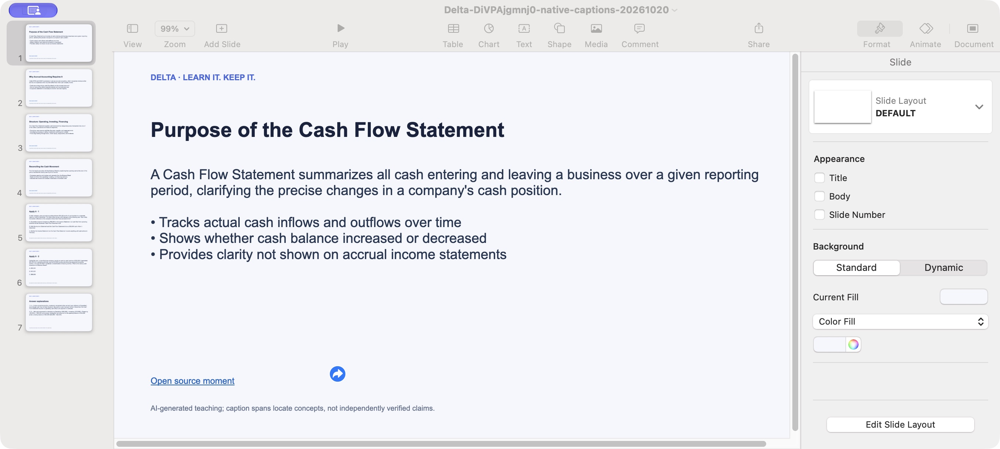

# Native extension and PPTX verification — 20 October 2026 (Hong Kong)

Current result: the sampled **0.7.1 native accounting path passed**: visible YouTube captions → Delta side panel → selected-video website → fresh Google sign-in → Gemini lesson → two exercise-key checks → source-linked recall → actual PPTX save and Keynote opening. Earlier caption-loading failures, intermittent sign-in failures and one unsupported recall result remain recorded below. This is qualification of one real source path, not all-features or all-video launch clearance.

## Actor, candidate and control path

An authorized maintainer Google test account was used in its personal Chrome profile. The initial SUMIF run reused saved learning without AI generation; the later accounting run below used one new lesson generation and two source questions. No purchase, personal-history import, credential or provider configuration change was made. Cloud Run `delta-assistant-ui-04bf778` still held 100% traffic in the final read-only observation.

### Initial SUMIF run

| Step | Actual observation | Verdict |
| --- | --- | --- |
| Native extension | Computer read the real Chrome toolbar and Delta side panel, then clicked **Learn current video** | Native control works; the earlier browser-only limitation was not a general prohibition on Computer control |
| Selected source | The extension opened a hosted learning action for public SUMIF video `dI8w0utjUc0` | Video identity and website handoff passed |
| Google sign-in | Three fresh attempts failed with `auth/popup-closed-by-user`; subsequent fresh standalone and hosted actions completed using native account selection | Recovery observed in two later attempts; intermittent failure root cause remains unproved |
| Lesson reuse | The hosted learning page showed the existing saved SUMIF lesson after sign-in | Existing local learning remained usable; this was not a newly generated lesson from captured captions |
| Caption handling | YouTube Show transcript remained on a spinner with no timestamped rows; Delta showed its unavailable-captions notice | Safe fallback observed; successful automatic ingestion remains unqualified |
| Native download | Computer clicked the prepared Blob Save link, handled Chrome's actual Save As dialog, and saved to Downloads | Actual filesystem save passed; the initial dialog location was `outputs`, which helps explain why earlier default-Downloads searches were insufficient |
| Native opening | The completed Chrome download opened in Keynote; the navigator showed seven slides and the first slide rendered its source link | Actual application opening passed |

The five fresh sign-in attempts are a diagnostic sequence, not a success-rate benchmark. Browser tooling reported a paused document response; cancelling its debugger and avoiding browser control was attempted, but automatic reattachment and a Picture-in-Picture focus change were also observed. These observations do not isolate a product, provider or tool root cause. No auth or cookie setting was changed. Existing earlier successful sign-in evidence does not erase these failures.

## Downloaded artifact

- Filename: `Delta-dI8w0utjUc0-native-20261020.pptx`.
- Size: **101,330 bytes**.
- SHA-256: `a97b8e9ebc6000f66d33a82c3965bd20f296a8731ad57f572f245e4b22384168`.
- ZIP CRC check: passed; PowerPoint content type present; **7 slide XML files**.
- Native Keynote: seven slide rows, lesson content and source link rendered. Opening the file did not require another AI request.

This capture contains the public teaching example, not a personal history or account screen.

## Installed package boundary

Chrome's native manager showed Delta **0.7.0** before the final reload check. The current public **0.7.1** ZIP was separately downloaded from Firebase Hosting and verified: 1,917,583 bytes, SHA-256 `c7116a0427ce50dacfcc500ab90ba431b4df7eda20cf0fc86fcbdca9eb5ffe55`. Its only difference from the UI 0.7.0 package used for this functional path is the manifest version; its other eleven files are identical. Permissions are unchanged.

The previously used unpacked directory was updated in place and all twelve files match the public 0.7.1 ZIP. Existing builds were backed up; no Chrome profile storage was edited. The initial Details/Reload observation could not finish because Computer access timed out, including a subsequent lightweight inventory attempt. **Later confirmation:** the user supplied a screenshot dated 20 October, 16:12 Hong Kong, showing the Chrome extension card as **Delta 0.7.1** with its toggle enabled. This confirms Chrome loaded the new version and supersedes the earlier unobserved-version limit. The screenshot does not show the Details installation path; that path was previously user-confirmed and its files were hash-verified, rather than independently captured in this screenshot. The supplied screenshot is retained privately with its digest; it is not redistributed here.

## Native follow-up — 20 October, 16:25 Hong Kong

After the user's 0.7.1 reload confirmation, Computer control recovered without a browser, provider or credential configuration change. It operated the real personal-Chrome Delta side panel on public accounting video `DiVPAjgmnj0`, chose **Learning lab → Learn current video**, and opened the matching hosted learning page.

One additional fresh Google sign-in completed after native selection of the authorized test account. An automatic Picture-in-Picture window took focus after account selection; pausing and closing that video window exposed the signed-in learning page, its account-credit controls and the existing saved accounting lesson. No new AI generation, source question, purchase or history import was requested. This is another observed recovery, not a demonstrated fix for the earlier intermittent auth failures.

YouTube's own **Show transcript** panel for the accounting video stayed on a loading indicator without timestamped rows. Cancelling the browser debugger and reloading the same page did not qualify a clean isolation: its debugging banner reappeared after the transcript interaction. Delta's capture finished with the explicit missing-captions notice and preserved the selected video. The earlier Khan Academy navigation showed its caption control as unavailable, but its transcript-panel action was not completed, so that navigation is not counted as a completed capture attempt.

A read-only review confirmed the installed reader expects visible `ytd-transcript-renderer` / `ytd-transcript-segment-renderer` rows. The 28 focused transcript and hosted-action tests passed. Those mocked contracts do not establish current YouTube markup compatibility, and a panel with zero rows does not prove selector drift. No runtime fix was made on that assumption. The actual PPTX save/open evidence above remains applicable and was not repeated.

## Actual caption recovery and complete accounting path — 20 October, 16:37 Hong Kong

The user asked Computer to perform the transcript check instead of handing it back. On the accounting YouTube page, Computer expanded the description and chose **Show transcript**. This time YouTube rendered timestamped caption buttons, including the cash/accrual explanation from 0:24 through 0:39. Delta's native **Learn current video** then opened a new matching hosted action. After fresh native Google account selection, the website displayed **Captions ready · 0:00–5:00**, without the missing-captions notice. No selector, auth or provider change was required for this recovery; the previous loading cause remains unproved.

| Check | Observed terminal result |
| --- | --- |
| Real caption input | Accounting video `DiVPAjgmnj0`, actual visible YouTube transcript, 0:00–5:00 handoff accepted |
| New lesson | **Understanding the Cash Flow Statement**, four teaching slides, two application exercises and three concepts; displayed model `gemini-3.8-flash` |
| Application practice | Both selected answers matched the generated keys; the transfer exercise's cash arithmetic was 25,000 + 40,000 − 15,000 − 5,000 = 45,000. This verifies UI/check persistence, not learning effectiveness or overall model accuracy |
| Source question 1 | A broader profit/cash recall question returned the explicit no-citation fallback. It was a completed charged request, not a transport error, and is not counted as a successful sourced answer |
| Source question 2 | A narrower cash-method/accrual-method comparison returned an explanation with two links, **0:00–0:30** and **0:30–0:58**. The cited visible caption spans cover cash recognition and accrual recognition |
| Cost | UI conservative estimate **US$0.0142** after generation; **US$0.0221 total** after both questions, including the unsuccessful recall result; below the **US$0.10** session ceiling. These are displayed paid-equivalent estimates, not a provider invoice |
| Fresh export | Chrome Save As completed; **102,072 bytes**, ZIP CRC passed, PowerPoint content type and **7 slide XML files**; native Keynote opened and rendered the newly generated deck |
| Saved state | Reloading the same authenticated learning tab retained the new lesson, both exercise-key matches, its source identity and the cumulative cost estimate. This is browser-local persistence, not a new cloud library |

New download: `Delta-DiVPAjgmnj0-native-captions-20261020.pptx`; SHA-256 `1c274c25da46e481fe0cd25f66023ac2c62873ed63d4ef3c433e469c8e161090`.

This reviewed capture contains the public teaching example and its actual output, without personal history, account details or access capabilities. The native source capture and sign-in were completed with Computer; after sign-in, browser control bound the exact new learning tab to avoid focus changes among older Delta tabs. Native Chrome handled Save As and Keynote opening.

A bounded, offline retrieval review found that repeated lesson versions can duplicate source anchors in the 16-slot retrieval window. A public-fixture replay reproduced crowding, but retained the relevant accounting anchor, so it **did not establish the cause** of question 1's miss. No runtime change or further model retry was made on that assumption. The narrower question's success does not erase the first miss.

## Remaining acceptance

1. Resolve or isolate the earlier intermittent fresh Google sign-in failures before claiming reliable new-user onboarding. The later successful logins establish recovery, not a demonstrated root-cause fix.
2. Retain the source-recall miss as a quality limit. One sampled caption path and one supported answer do not establish compatibility with every video, language or question.

Store distribution, live billing and monitoring are separate retained launch limits in the [full product report](full-product-2026-10-20.md). This run changed no runtime code, so the applicable existing deterministic and image gates were retained rather than rerun as a substitute for native proof.
