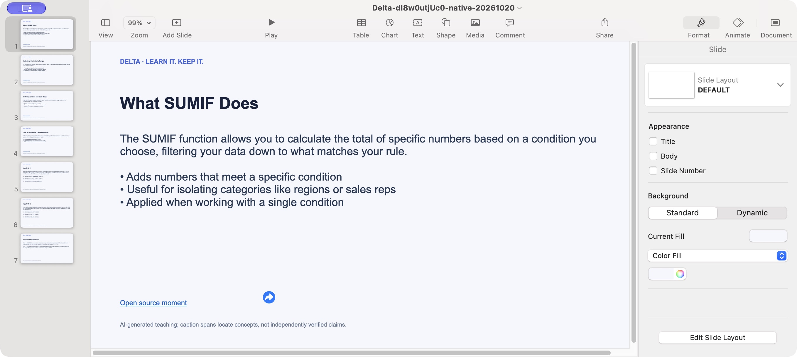

# Native extension and PPTX verification — 20 October 2026 (Hong Kong)

Result: Computer control completed the native side-panel launch, the selected-video website handoff, Google sign-in, reuse of a saved SUMIF lesson, an actual Chrome Save As, and opening the downloaded PowerPoint in Keynote. Automatic caption ingestion was **not** qualified: YouTube's transcript panel remained on a loading spinner for the sampled video, and Delta displayed its explicit missing-captions fallback. This is not all-features launch clearance.

## Actor, candidate and control path

An authorized maintainer Google test account was used in its personal Chrome profile. No new purchase, AI generation, personal-history import, credential or provider configuration change was made. The learning website remained on Cloud Run `delta-assistant-ui-04bf778`, with 100% traffic observed during this run.

| Step | Actual observation | Verdict |
| --- | --- | --- |
| Native extension | Computer read the real Chrome toolbar and Delta side panel, then clicked **Learn current video** | Native control works; the earlier browser-only limitation was not a general prohibition on Computer control |
| Selected source | The extension opened a hosted learning action for public SUMIF video `dI8w0utjUc0` | Video identity and website handoff passed |
| Google sign-in | Three fresh attempts failed with `auth/popup-closed-by-user`; subsequent fresh standalone and hosted actions completed using native account selection | Recovery observed in two later attempts; intermittent failure root cause remains unproved |
| Lesson reuse | The hosted learning page showed the existing saved SUMIF lesson after sign-in | Existing local learning remained usable; this was not a newly generated lesson from captured captions |
| Caption handling | YouTube Show transcript remained on a spinner with no timestamped rows; Delta showed its unavailable-captions notice | Safe fallback observed; successful automatic ingestion remains unqualified |
| Native download | Computer clicked the prepared Blob Save link, handled Chrome's actual Save As dialog, and saved to Downloads | Actual filesystem save passed; the initial dialog location was `outputs`, which helps explain why earlier default-Downloads searches were insufficient |
| Native opening | The completed Chrome download opened in Keynote; the navigator showed seven slides and the first slide rendered its source link | Actual application opening passed |

The five fresh sign-in attempts are a diagnostic sequence, not a success-rate benchmark. Browser tooling reported a paused document response; cancelling its debugger and avoiding browser control was attempted, but automatic reattachment and a Picture-in-Picture focus change were also observed. These observations do not isolate a product, provider or tool root cause. No auth or cookie setting was changed. Existing earlier successful sign-in evidence does not erase these failures.

## Downloaded artifact

- Filename: `Delta-dI8w0utjUc0-native-20261020.pptx`.
- Size: **101,330 bytes**.
- SHA-256: `a97b8e9ebc6000f66d33a82c3965bd20f296a8731ad57f572f245e4b22384168`.
- ZIP CRC check: passed; PowerPoint content type present; **7 slide XML files**.
- Native Keynote: seven slide rows, lesson content and source link rendered. Opening the file did not require another AI request.

This capture contains the public teaching example, not a personal history or account screen.

## Installed package boundary

Chrome's native manager showed Delta **0.7.0** before the final reload check. The current public **0.7.1** ZIP was separately downloaded from Firebase Hosting and verified: 1,917,583 bytes, SHA-256 `c7116a0427ce50dacfcc500ab90ba431b4df7eda20cf0fc86fcbdca9eb5ffe55`. Its only difference from the UI 0.7.0 package used for this functional path is the manifest version; its other eleven files are identical. Permissions are unchanged.

The previously used unpacked directory was updated in place and all twelve files match the public 0.7.1 ZIP. Existing builds were backed up; no Chrome profile storage was edited. The initial Details/Reload observation could not finish because Computer access timed out, including a subsequent lightweight inventory attempt. **Later confirmation:** the user supplied a screenshot dated 20 October, 16:12 Hong Kong, showing the Chrome extension card as **Delta 0.7.1** with its toggle enabled. This confirms Chrome loaded the new version and supersedes the earlier unobserved-version limit. The screenshot does not show the Details installation path; that path was previously user-confirmed and its files were hash-verified, rather than independently captured in this screenshot. The supplied screenshot is retained privately with its digest; it is not redistributed here.

## Remaining acceptance

1. Qualify one actual timestamped-caption capture from YouTube through the native entry; the sampled SUMIF transcript did not load.
2. Resolve or isolate intermittent fresh Google sign-in failures before claiming reliable new-user onboarding.

Store distribution, live billing and monitoring are separate retained launch limits in the [full product report](full-product-2026-10-20.md). This run changed no runtime code, so the applicable existing deterministic and image gates were retained rather than rerun as a substitute for native proof.
