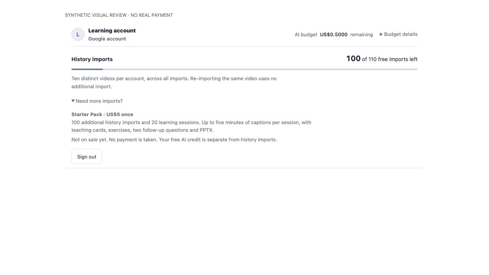
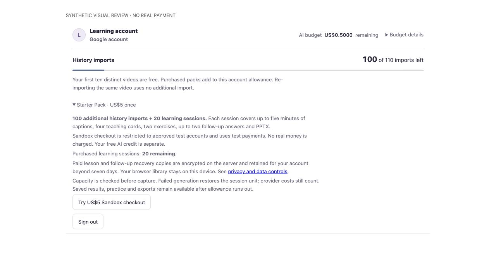
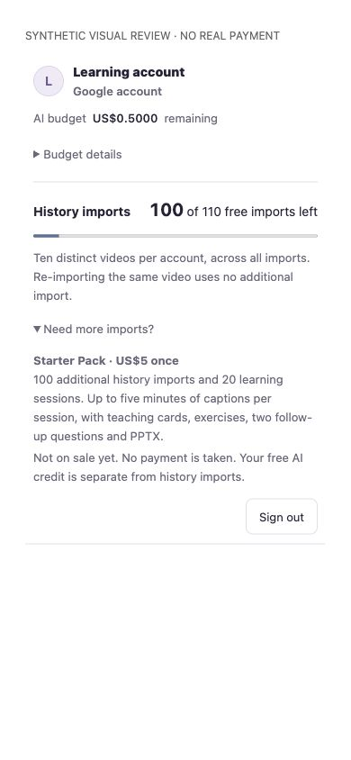
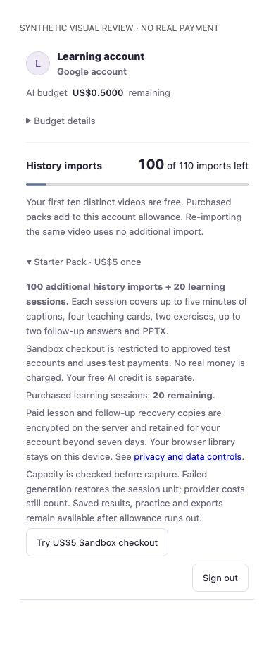

# Starter Pack Sandbox candidate — 20 October 2026

Status: implemented and locally verified; **not deployed, not a live payment launch, and not app-to-Stripe end-to-end qualified**. New sales are disabled by default. The merchant selected by the owner is the vic-ai-mvp Sandbox. There is no live-mode enable path in this candidate.

## Product and compatibility

- USD5 once adds 100 distinct-video import registrations and 20 bounded learning sessions. The first ten lifetime free imports and original USD0.50 lifetime estimated AI allowance keep their existing schemas and signing identity. A paid request explicitly selects its allowance, and works when free AI credit is exhausted.
- Each paid session covers a caption excerpt of at most five minutes, four cards, two application exercises, up to two successful distinct follow-up answers and existing PPTX export. Practice/reopen/export use no new unit. A failed generation restores its unit; its provider cost/unknown reservation is retained. Identical results are replayed without another successful unit.
- Paid lesson/source and follow-up capabilities are AES-GCM encrypted in a separate Firestore recovery collection. The owner requested retention beyond seven days; these copies persist until an account-content removal request or service retirement. They are not Google Drive integration or general cloud library synchronisation. Free content keeps its runtime-cache boundary. Privacy/support notices and purchase UI explain this distinction.
- The default native import remains latest ten. An optional latest-100 scope and up-to-100 selected Chrome visits require sufficient verified account allowance before persistence. Removing local records does not reset registered IDs.

## Payment and abuse boundaries

Checkout parameters are server-owned: one pack, USD500 cents, card-only, no promotion code, no adaptive currency or automatic tax, manual capture. Before capture, the transaction reserves USD2.50 from the **existing unchanged USD10 project ledger**: learning USD2, classification USD0.25, recovery USD0.25. Insufficient capacity cancels the authorization instead of granting an unfunded pack.

Only explicitly configured verified test UIDs may open or fulfil Sandbox purchases, preventing arbitrary public test cards from minting real Gemini spending capacity. Expected account, test mode, full amount, item, owner, order and PaymentIntent bindings are checked from canonical Stripe state. A signed event or browser return alone cannot grant a pack. Unknown capture keeps capacity reserved; reconciliation checks the existing payment. Duplicate/out-of-order delivery cannot duplicate the grant. Confirmed refund/dispute withdraws unused rights while in-flight usage still settles conservatively.

The sole `/api/billing/stripe-webhook` route verifies the exact bounded raw bytes with Stripe's timestamped signature verifier. Its origin exemption does not extend to browser purchase routes. Purchase/reconcile require verified identity and ownership, including when local learning is configured. Unconfigured payment secrets close new sales without disabling saved learning or sign-in. SDK failures retain allowlisted type/code/status/request correlation, without keys, headers or provider bodies.

## Verification

| Check | Result |
|---|---|
| Server suite | 412 passed; 0 failed |
| Extension suite | 310 passed; 0 failed |
| Competition packaging suite | 9 passed; 0 failed |
| Web and MV3 builds | Passed |
| Production dependency audit | 0 reported advisories |
| Built MV3 archive | Declared assets, paths, CRCs and hashes checked; receipt below |
| Browser visual review | Synthetic account, 1280x720 and 390x844; no horizontal overflow |

The integration tests execute the actual HTTP router, raw webhook verifier, Firestore adapters/reducers, paid funding service, source validation, owned encryption, practice and real PPTX generation. External Google verification, Firestore IO, Stripe capture and Gemini output are controlled fixtures. They cover zero-free-credit paid use, two answers/third denial, replay after runtime loss, 20-unit admission, UID isolation, unpaid/foreign/mismatched events, capacity races, failure accounting, refund-in-flight and disabled-config compatibility. These are deterministic wiring/security checks, not model accuracy, learning efficacy or real installed-browser payment evidence.

One extension assertion was updated to the new truthful allowance message; status-402 and unchanged-local-record checks remain. A new paid-classification test first failed because the strict metadata parser rejected the funding field. Funding is now separated before the same strict parser; unknown fields remain rejected.

### Exact local archive

`Delta-Chrome-MVP-0.7.0-sandbox-candidate.zip` contains 12 verified MV3 files, 1,909,792 bytes. SHA-256: `19e6b4a242c7a30c5e20631f3fe322d2b3362cafb96c2b5b1ad01f3e5d8d4b74`. The archive remains ignored/local; the hosted download and installed extension were not replaced.

### Real provider contract probe

The connected Stripe tool created one unpaid Sandbox Checkout Session with the fixed USD5/card/manual-capture parameters. No card was entered, no charge captured and no entitlement granted. One earlier create failed because `ui_mode=hosted` is no longer accepted by the connector's API version; omitting the optional parameter uses the official hosted default and succeeded. The disposable unpaid session expires automatically. This proves parameter acceptance through the connector, **not the application SDK credential, signed delivery, Firestore transaction or complete Checkout flow**. No real Gemini generation was made in this implementation run.

### Paired visual evidence

Same synthetic account, data, locale and expanded offer; before is public source `8275bf22`, after is this candidate. These images show UI only, not an actual purchase. No private history, identity or credential appears.

| View | Before | After |
|---|---|---|
| Desktop |  |  |
| Phone |  |  |

The offer now distinguishes purchased allowance from free AI credit, shows the paid session balance, labels Sandbox-only checkout and its verification state, and discloses retained encrypted recovery copies. Original-size images are linked above.

## Remaining release qualification

Provision a restricted Sandbox API key and signed webhook secret privately, configure the approved test UID allowlist, then qualify the exact packaged candidate through normal Google sign-in, hosted Checkout, signed webhook/canonical capture, paid imports and a paid learning/export flow. Repeat with declined/canceled payment and duplicate delivery. The current local Google principal could not query the test UID: Google returned HTTP403 `SERVICE_DISABLED`; no API, IAM or billing configuration was changed. Do not infer that the test user is absent or that deployed sign-in is broken.

Do not enable live money, promote this archive as installed/store-qualified, replace the hosted download or raise the project budget from this report. Operator support is required for a provider operation that remains genuinely ambiguous; there is no blind retry, automatic refund or hidden credit reset.
