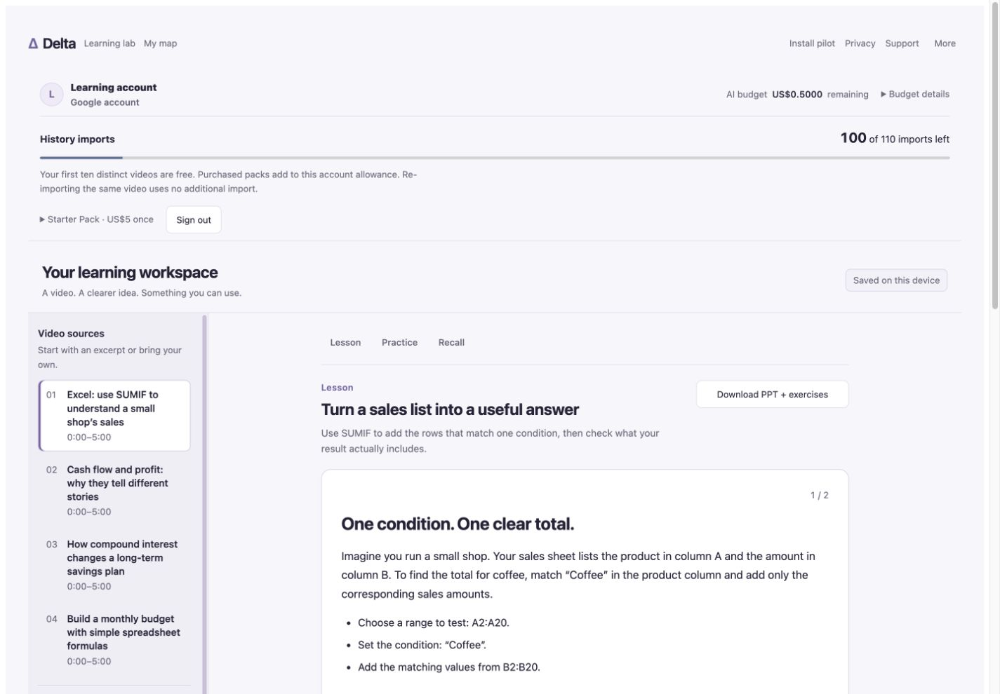
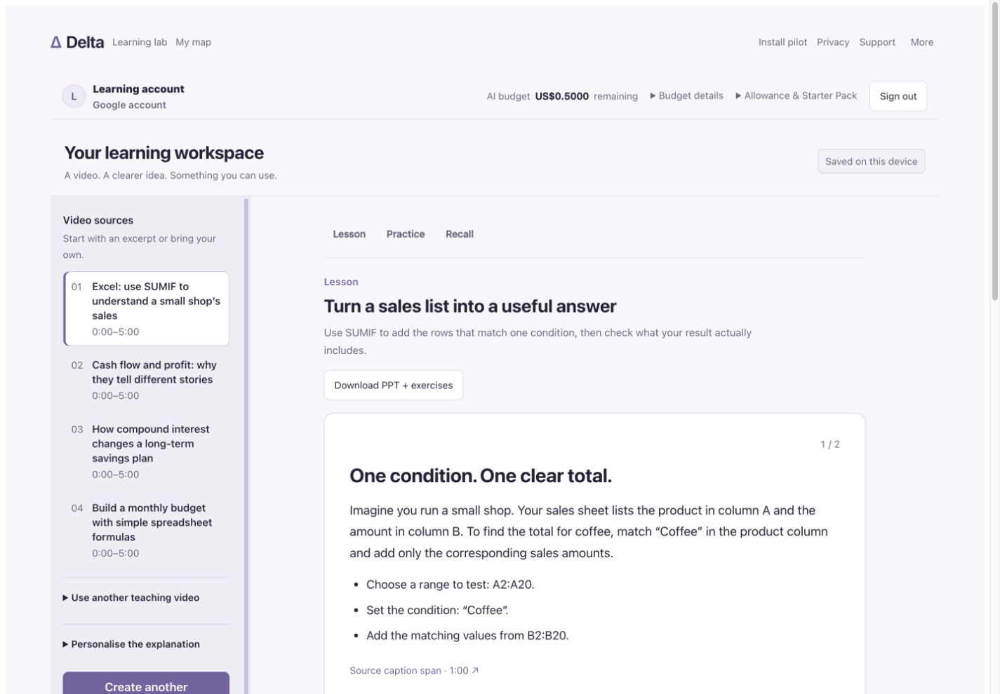
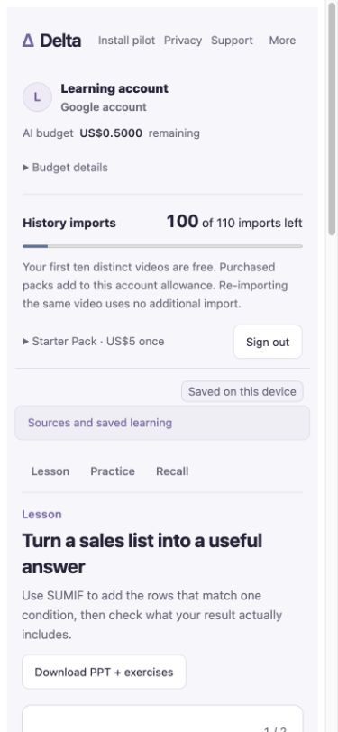
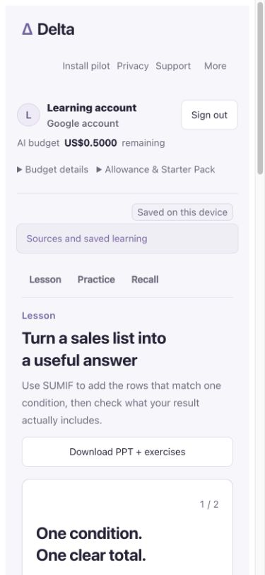
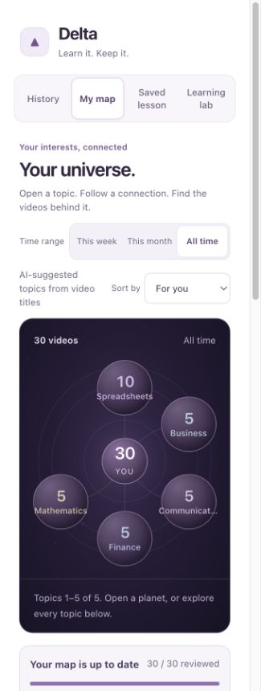
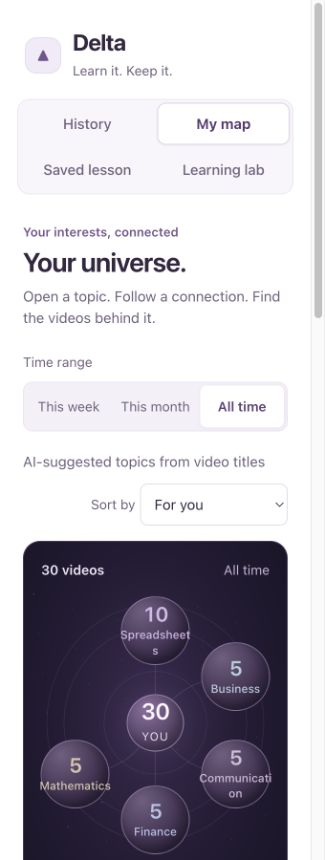
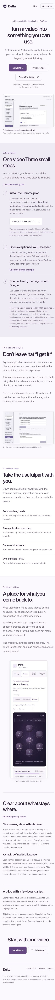
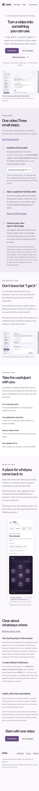

# Delta UI readability — 20 October 2026

The typography and responsive UI update is live at [Delta](https://delta-assistant-613646062582.us-central1.run.app/learn?study=1) and the [public entry](https://delta-511903.web.app/).

## Exact release

- Packaged implementation: `04bf7782cab5d30160db2a34f7fecb21e5a3ad63` (UI commit `b8b3afc`; later merge only reconciled existing engineering evidence). Public code equivalent: `1fcfee0820e00214acd4123873028870e205185c`.
- Cloud Run revision: `delta-assistant-ui-04bf778`, **100% traffic**. Image digest: `sha256:562e58b4ea299dca7dd780c19f282264ee9460adaa179725e321e46c7da8e0bd`.
- Candidate input: `18b7a2d9df36dbf1d257bbecdd416ad425b74b04cff03bf766d51c625f21dda5`. Local image: `sha256:6b1aa6bc2c08b7edde6ff8da7cae23d06ffcbe76523e3ec811ed7a060257f288`.
- [MV3 ZIP 0.7.0](https://delta-assistant-613646062582.us-central1.run.app/downloads/Delta-Chrome-MVP-0.7.0.zip): 12 files, **1,917,583 bytes**, SHA-256 `a77d8de508d5ae5a14eb6cff6d6aa475e5bc701ae936c4f9b91c36d61b895275`. Version 0.7.0 alone does not identify the build; use this digest.

The complete runtime container configuration, secret references, service identity, model/provider, auth, quotas, resource limits and Sandbox billing settings were preserved. Only the image and the intended traffic destination changed. Hosting deployment changed only the existing static site. Both Hosting domains and their reserved `/__/auth/handler` returned 200 afterward.

## What changed

Main teaching text is 17–18px at the default browser size, with a 1.7 line height. Secondary text generally uses 14–16px, with a separate heading scale. Font sizes use rem; paragraph widths stay bounded. The lavender/purple and neutral palette, system fonts and existing brand remain.

The lesson area has a wider reading column and more space between groups. Download controls sit beneath the lesson introduction instead of squeezing its title. The source rail remains scroll-bounded. The signed-in account bar groups import allowance and Starter Pack details into one disclosure; a valid purchase-return URL automatically opens both that disclosure and the existing purchase recovery controls.

My map, History and their import controls have readable labels, stronger text contrast and 44px minimum targets for principal controls. Narrow panel navigation uses two rows. Long topic labels can wrap, and topic/video lists retain their existing pagination and scroll bounds. Onboarding uses the same comfortable type hierarchy and readable supporting copy, with the existing approved product images retained.

## Verification

| Check | Result |
| --- | --- |
| Required final gate | Node **24.18.0**; 424 server + 310 extension + 15 web + 9 packaging = **758 passed**; Web and extension builds passed |
| Responsive reflow | Lesson, empty lesson, signed-out entry, map, panel and onboarding at 320, 390, 768 and 1440px: **24 views without page overflow** |
| 200% text | Five surfaces at 320, 768 and 1440px. Three narrow-width overflows were found and fixed; focused rechecks passed. Wider checks remained applicable |
| Interaction | Practice selection enables checking; keyboard focus remains visible; source rail opens; error/recovery text remains visible; map topic navigation works; History initially renders 12 records; purchase-return recovery remains visible |
| Loading and images | Loading status keeps `aria-busy`; no phone overflow. All onboarding images loaded after scrolling; Install anchor and keyboard focus passed |
| Exact image smoke | Non-root, read-only filesystem, network disabled, four prepared caption sources, exact ZIP, private paths denied, invalid tokens denied; **zero provider calls** |
| Live terminal checks | All service Ready conditions True; 100% traffic on the new revision; live learning JS/CSS byte-match the exact image; both Hosting HTML/CSS byte-match the candidate; ZIP digest/CRC/manifest and 12-file inventory match |
| Existing boundaries | Anonymous session/entitlements remain 401; private environment/caption/artifact paths remain 404; public auth config still reports US$0.50 |

Server, dependency, auth, payment, quota and extension-background inputs are unchanged from the supported functional baseline. Existing authenticated payment and learning receipts were retained; no new purchase, personal-history import or paid/model generation was performed for this styling work. The signed-out live website and onboarding were visually checked after promotion. Authenticated lesson/map/purchase layouts were exercised using the real components with controlled synthetic data; this is not a new live authenticated functional E2E claim.

## Controlled Before / After

Before: implementation `358b905`, preceding the typography change. After: UI `b8b3afc` / packaged `04bf778` (runtime UI files are identical). Each pair uses the same synthetic teaching content, account label, selected lesson, locale and viewport override. Browser screenshots exclude scrollbar/chrome space: the desktop content capture is 1425 × 990, the phone lesson 375 × 812 and the panel 325 × 860; full-page onboarding keeps the same 375px content width. No personal history, real learner token or account record appears. Images link to their original-size files.

### Learning workspace · 1440 × 1000

| Before | After |
| --- | --- |
|  |  |

### Learning workspace · 390 × 844

| Before | After |
| --- | --- |
|  |  |

### Chrome panel map · 340 × 900

| Before | After |
| --- | --- |
|  |  |

### Onboarding · 390px, full page

| Before | After |
| --- | --- |
|  |  |

## Retained limits

This updates the live website and published ZIP. It does not replace or reload an existing unpacked Chrome installation. The earlier native verification used the previous exact ZIP; the new ZIP has not been qualified as an installed native extension. No Chrome profile, local history or library was changed here. Native caption handoff remains under the separate functional verification task.

The user confirmed downloading and opening the prepared PPTX in the functional follow-up; that is user-assisted acceptance, not independent automated file inspection. Earlier intermittent Google sign-in reports remain unresolved at root-cause level. Real-money billing and Chrome Web Store approval are not enabled or claimed.

### Modern Web Guidance

- **`typography`**: I used rem sizes, unitless line heights, bounded paragraphs and deliberate heading wrapping, then checked 200% text resizing: “Support user zoom preferences”.
